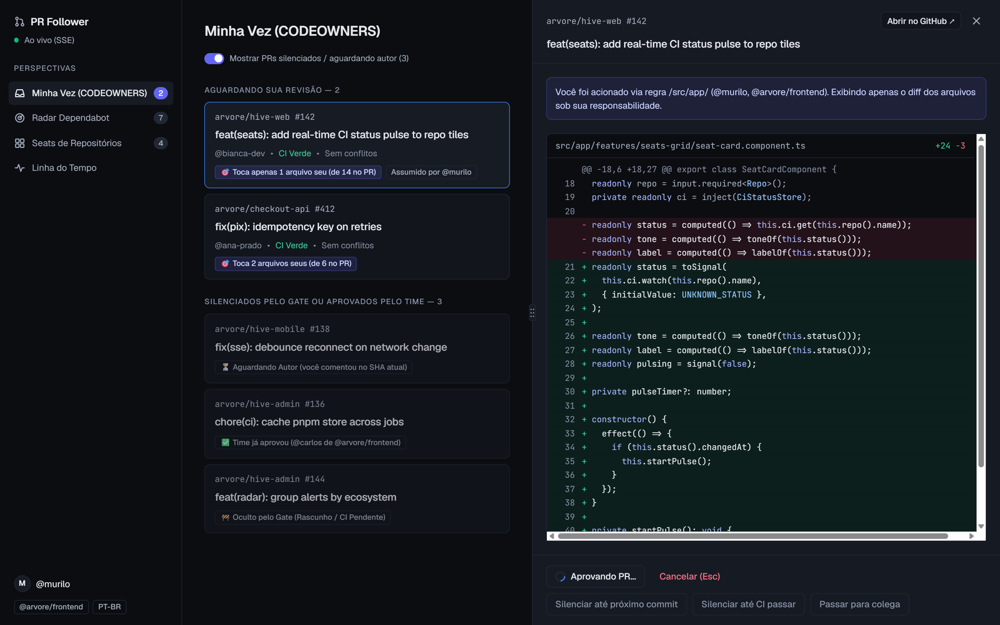
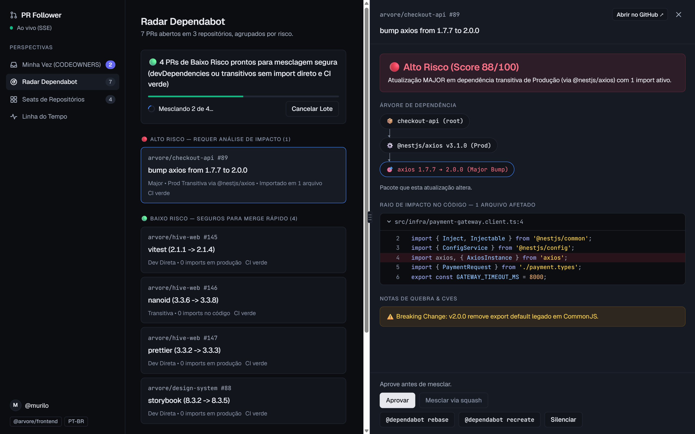
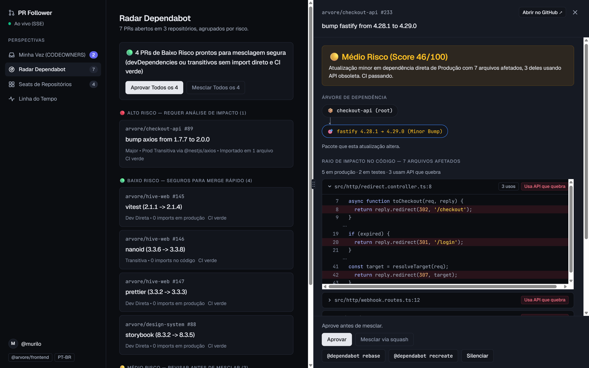
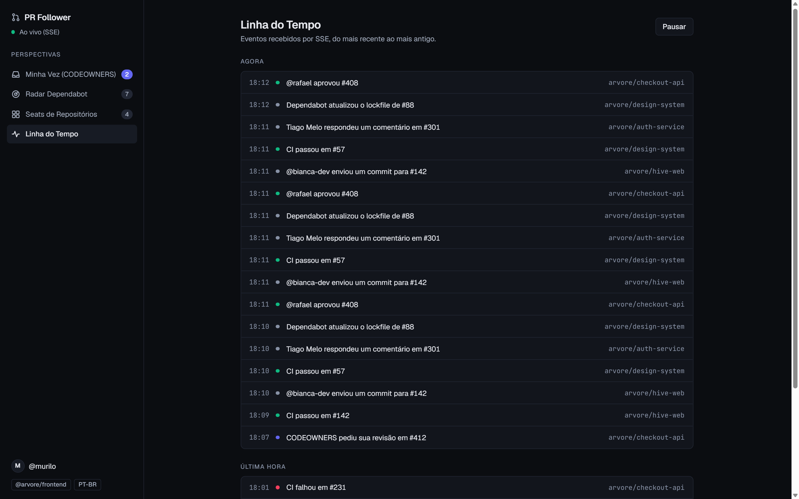

# PR Follower

> One live dashboard for the pull requests that depend on you: CODEOWNERS review requests and Dependabot PRs, with what matters in each.

[](https://github.com/muriIo/pr-follower/actions/workflows/ci.yml)
[](https://github.com/muriIo/pr-follower/actions/workflows/security.yml)
[](LICENSE)

[Português (Brasil)](README.md) · **English**



## Why PR Follower exists

It grew out of two everyday annoyances of working on a team with many GitHub repositories:

- **CODEOWNERS turns into an inbox.** Every PR that touches a file you own sends notifications: review requests, comments, approvals, CI. Following each one's state by email is tiring, and it is hard to tell which PRs need you now and which a teammate from your group already handled.
- **Dependabot PRs get forgotten.** They arrive in bulk, and deciding whether a bump is safe takes time and context a team rarely has: is the dependency direct or transitive? production or development only? does the code import it anywhere? When in doubt, the PR sits for weeks.

PR Follower brings both into one clean place with no mental overload: it shows only what is yours, says whose turn it is, analyses the impact of each Dependabot update, and lets you approve and merge without switching tabs. Everything updates live.

## What it does

**My Turn (CODEOWNERS).** Reads each repository's `CODEOWNERS` and matches it against the PR's changed files. You see only the PRs that touch files you (or your team) own, and in the side panel the diff of just those files. A PR leaves your queue when you approve it, when a teammate from the same group approves it, or when you commented and are waiting on the author; it comes back with a new commit.

**Dependabot Radar.** Groups updates by risk. For each one it shows the dependency's path in the lockfile (direct or transitive, production or development) and its blast radius: where your code imports the package. Low-risk updates with green CI can be merged in a batch.





**Actions without leaving the dashboard.** Approve, squash-merge, batch-merge, comment `@dependabot rebase` or `recreate`, snooze until the next commit or until CI passes, claim a PR. Every action reaches GitHub as **you**, can be cancelled midway, and a failure always shows the reason GitHub gave.

**Seats and Timeline.** A card per followed repository with its open PRs and CI pulse, and a timeline of everything happening in your repositories, in real time (GitHub webhooks delivered to the browser through Server-Sent Events).



> The images come from the design prototype. The current interface follows the same design; a few details, such as the numeric risk score and the CVE digest, are not implemented yet (see the [roadmap](docs/roadmap.md)). The interface is in Brazilian Portuguese by default and also available in English.

## Pros and cons

This is my first open-source project, and I would rather you know exactly what to expect.

**Pros**

- **Shows only what is yours.** The queue comes from `CODEOWNERS` (with GitHub's pattern rules) and each commit's changed files, not from a notification list.
- **Knows whose turn it is.** "Approved by me", "a teammate already approved" and "waiting on the author" come from the reviews GitHub recorded for the current commit; a new commit puts the PR back in your queue.
- **Helps you decide on Dependabot.** Scope, depth and real use of the package in your code, read from the lockfile and from the repository's code in memory, without cloning anything.
- **Honest about what it does not know.** A PR whose files were not read yet shows as not checked yet, never as "nothing for you"; a merge GitHub did not confirm shows as unconfirmed, never as a success.
- **Runs on your infrastructure.** You use your own GitHub App; no data goes through anyone else's servers. Two containers and a Postgres, on any cloud or server, with as many replicas as you like.
- **Built with care.** Tests written before the code, architecture decisions with automated checks ([ADRs](docs/adr/README.md)), and security scans on every PR and every week.

**Cons and limitations**

- **You host it.** There is no ready-made cloud version: you need a GitHub App, a Postgres and a domain with HTTPS. The [install guide](INSTALL.md) takes about an hour the first time.
- **GitHub only.** It does not work with GitLab or Bitbucket.
- **Dependabot analysis for npm only.** It reads `package-lock.json`; with yarn and pnpm the dependency path is partial, and grouped updates (several packages in one PR) and other ecosystems (Go, Python…) show as "Not analysed".
- **No automatic resync after an outage.** If the API was down, the **Sync** button fetches what changed; a PR opened and merged during the outage does not appear.
- **Does not explain a blocked merge.** When branch protection blocks a merge, the dashboard says it is blocked but not yet why (missing approvals, a required check).
- **A young project with one maintainer.** It is still at version 0.x, and the open items are in the [roadmap](docs/roadmap.md).
- **Portuguese interface by default.** English is available; other languages are not yet.

## Coming from another tool?

| You use today | What stays the same | What PR Follower adds |
|---|---|---|
| GitHub notifications and email | You still get everything on GitHub, if you want it. | A queue with only the PRs that touch your files, and whose turn it is on each. |
| GitHub's review requests page | The same PRs, the same reviews. | The diff of only your files, CI and merge state, and the actions in one place, live. |
| Dependabot on its own | The PRs are still Dependabot's, on GitHub. | Risk, dependency path and code usage for each update, and batch merging of the safe ones. |

## Installation

See **[INSTALL.md](INSTALL.md)**: create the GitHub App, generate the secrets and pick a path, all cloud-agnostic:

- **One machine with Docker Compose** (Postgres, API, dashboard and Caddy with automatic HTTPS), in [`deploy/compose`](deploy/compose).
- **Kubernetes**, with ready manifests in [`deploy/kubernetes`](deploy/kubernetes).
- **Any managed container platform**, with the list of what it must provide.

To develop locally: `cp .env.example .env`, fill it in with a development GitHub App, and run `make dev` (dashboard at `http://localhost:4200`). Details in [AGENTS.md](AGENTS.md).

## How it works

```
GitHub ── webhooks ──▶ API (Go) ──▶ Postgres ──▶ API (Go) ── live events (SSE) ──▶ browser
   ▲                                                                                 │
   └──────────── approve, merge, comment (as the user) ◀──── dashboard (Angular) ─────┘
```

GitHub notifies the API through webhooks; the API keeps the state in Postgres and tells the connected browsers. Reads use the GitHub App's token; actions (approve, merge, comment) use the token of whoever clicked, so that person's permissions on the repository apply. Any API replica serves any request.

## Security

PR Follower stores GitHub tokens (encrypted at rest) and acts on repositories on users' behalf, so security is taken seriously: see how to report a vulnerability in [SECURITY.md](SECURITY.md) and how the project checks itself in [docs/security.md](docs/security.md).

## Documentation

| File | What it is |
|---|---|
| [INSTALL.md](INSTALL.md) | Installing on any infrastructure. |
| [docs/production-setup.md](docs/production-setup.md) | The full production runbook: every variable, operations and troubleshooting. |
| [docs/aws-setup.md](docs/aws-setup.md) | A complete example on AWS. |
| [docs/roadmap.md](docs/roadmap.md) | What is done and what is open, by module. |
| [docs/adr/](docs/adr/README.md) | The architecture decisions, each with its automated check. |
| [docs/security.md](docs/security.md) | Security scanning and the results of the first full scan. |
| [docs/business-and-distribution.md](docs/business-and-distribution.md) | The project's model and how it is distributed. |
| [AGENTS.md](AGENTS.md) | How to contribute: structure, rules and commands. |

## Help and feedback

**Feedback is very welcome.** This is my first open-source project, and hearing what worked, what was confusing and what was missing is what helps me most.

- **Help and conversation:** reach me on [Discord](https://discord.com/users/940577105761140746).
- **Bugs and ideas:** open an [issue](https://github.com/muriIo/pr-follower/issues).
- **Vulnerabilities:** privately, as described in [SECURITY.md](SECURITY.md).

If the project is useful to you, a ⭐ on the repository helps others find it.

## License

Licensed under the [Apache License 2.0](LICENSE). Copyright 2026 Murilo Cruz; see [NOTICE](NOTICE).

## Acknowledgements

Built in partnership with [Claude Code](https://claude.com/claude-code); the user experience is inspired by [Hive](https://github.com/arvoreeducacao/hive).
