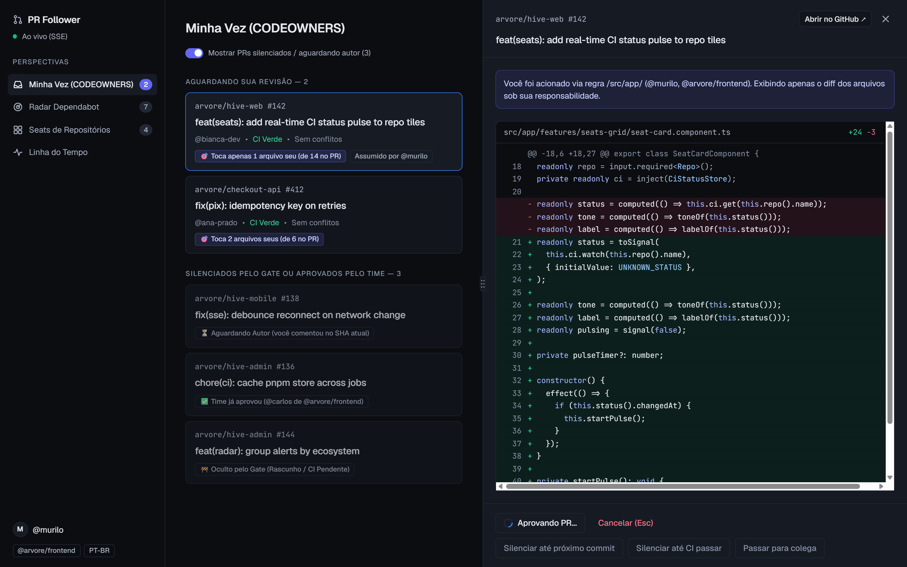
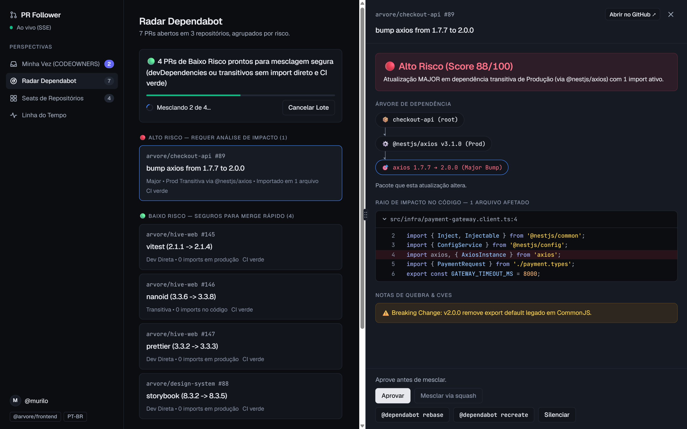
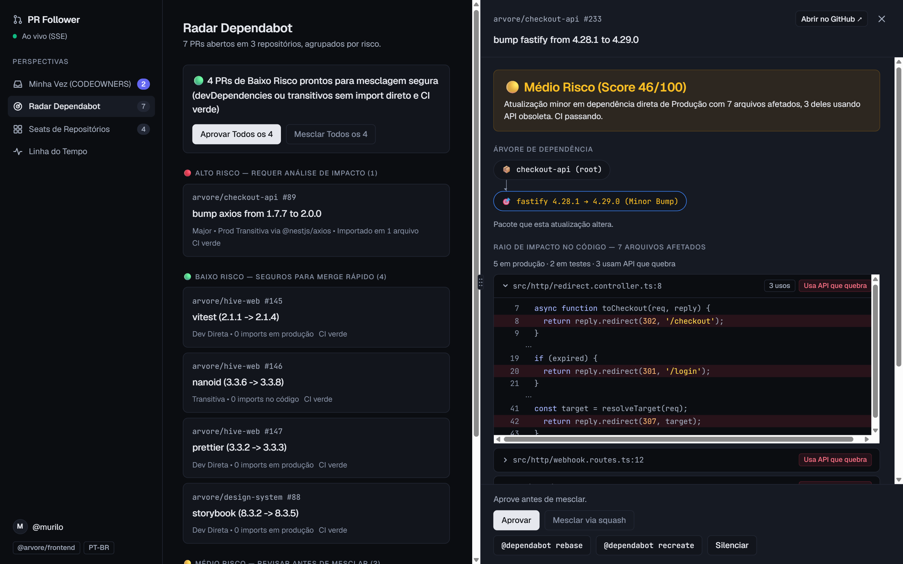
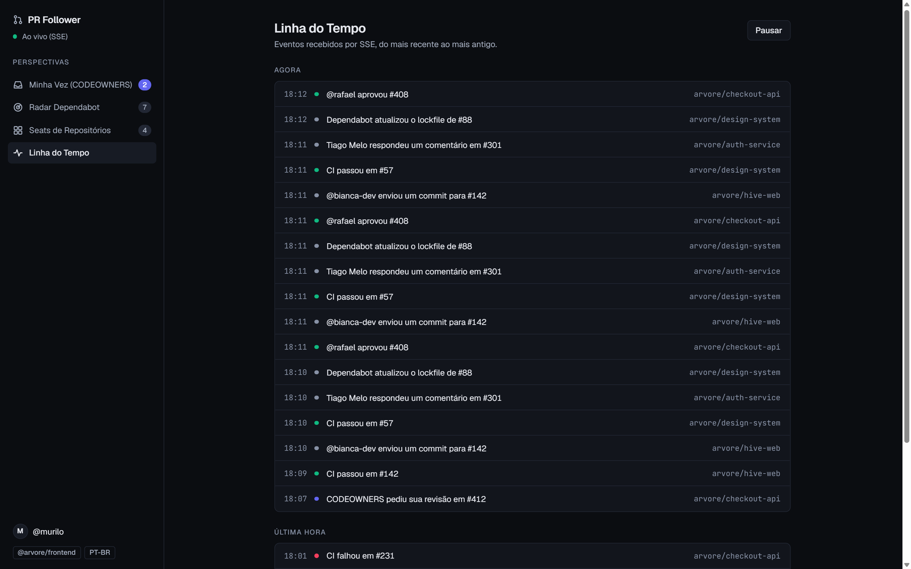

# PR Follower


> Um painel único e ao vivo para os PRs que dependem de você: revisões pedidas pelo CODEOWNERS e PRs do Dependabot, com o que importa em cada um.

[](https://github.com/muriIo/pr-follower/actions/workflows/ci.yml)
[](https://github.com/muriIo/pr-follower/actions/workflows/security.yml)
[](LICENSE)

**Português (Brasil)** · [English](README.en-US.md)



## Por que o PR Follower existe

Ele nasceu de dois incômodos do dia a dia de quem trabalha num time com muitos repositórios no GitHub:

- **O CODEOWNERS vira caixa de e-mail.** Cada PR que encosta num arquivo seu gera notificações: pedido de revisão, comentário, aprovação, CI. Acompanhar o estado de cada um pelo e-mail é cansativo, e é difícil saber em qual PR é a sua vez de agir e em qual um colega do seu time já resolveu.
- **Os PRs do Dependabot ficam esquecidos.** Eles chegam em quantidade, e decidir se um "bump" é seguro pede tempo e contexto que o time nem sempre tem: a dependência é direta ou transitiva? de produção ou só de desenvolvimento? o código importa esse pacote em algum lugar? Na dúvida, o PR fica parado por semanas.

O PR Follower junta os dois num só lugar, limpo e sem sobrecarga: mostra só o que é seu, diz de quem é a vez, analisa o impacto de cada atualização do Dependabot e deixa você aprovar e mesclar sem trocar de aba. Tudo atualiza ao vivo.

## O que ele faz

**Minha Vez (CODEOWNERS).** Lê o `CODEOWNERS` de cada repositório e cruza com os arquivos alterados no PR. Você vê apenas os PRs que mexem em arquivos seus (ou do seu time) e, no painel lateral, o diff só desses arquivos. O PR sai da sua fila quando você aprova, quando um colega do mesmo grupo aprova, ou quando você comentou e está esperando o autor; volta quando chega um commit novo.

**Radar Dependabot.** Agrupa as atualizações por risco. Para cada uma, mostra o caminho da dependência no lockfile (direta ou transitiva, produção ou desenvolvimento) e o raio de impacto: onde o pacote é importado no seu código. As de baixo risco com CI verde podem ser mescladas em lote.





**Ações sem sair do painel.** Aprovar, mesclar via squash, mesclar em lote, comentar `@dependabot rebase` ou `recreate`, silenciar até o próximo commit ou até o CI passar, assumir um PR. Toda ação vai para o GitHub com a **sua** conta, pode ser cancelada no meio, e uma falha sempre aparece com o motivo que o GitHub deu.

**Seats e Linha do Tempo.** Um cartão por repositório seguido, com os PRs abertos e o pulso do CI, e uma linha do tempo com tudo o que acontece nos seus repositórios, em tempo real (webhooks do GitHub entregues ao navegador por Server-Sent Events).



> As imagens são do protótipo de design. A interface atual segue o mesmo desenho; alguns detalhes, como a nota numérica de risco e o resumo de CVEs, ainda não estão implementados (veja o [roadmap](docs/roadmap.md)).

## Prós e contras

Este é o meu primeiro projeto open source, e prefiro que você saiba exatamente o que esperar.

**Prós**

- **Mostra só o que é seu.** A fila é calculada a partir do `CODEOWNERS` (com as regras de padrão do GitHub) e dos arquivos alterados em cada commit, não de uma lista de notificações.
- **Sabe de quem é a vez.** "Aprovado por mim", "um colega já aprovou" e "esperando o autor" vêm das revisões registradas no GitHub para o commit atual; um commit novo devolve o PR para a sua fila.
- **Ajuda a decidir sobre o Dependabot.** Escopo, profundidade e uso real do pacote no código, lidos do lockfile e do código do repositório em memória, sem clonar nada.
- **Honesto sobre o que não sabe.** Um PR cujos arquivos ainda não foram lidos aparece como ainda não verificado, nunca como "sem nada para você"; um merge que o GitHub não confirmou aparece como não confirmado, nunca como sucesso.
- **Roda na sua infraestrutura.** Você usa o seu próprio GitHub App; nenhum dado passa pelos servidores de outra pessoa. Dois containers e um Postgres, em qualquer nuvem ou servidor, com quantas réplicas quiser.
- **Feito com cuidado.** Testes escritos antes do código, decisões de arquitetura com verificação automática ([ADRs](docs/adr/README.md)), e varredura de segurança em todo PR e toda semana.

**Contras e limitações**

- **Você precisa hospedar.** Não existe uma versão pronta na nuvem: é preciso criar um GitHub App, ter um Postgres e um domínio com HTTPS. O [guia de instalação](INSTALL.md) leva cerca de uma hora na primeira vez.
- **Só GitHub.** Não funciona com GitLab ou Bitbucket.
- **Análise do Dependabot só para npm.** Lê `package-lock.json`; com yarn e pnpm o caminho da dependência é parcial, e atualizações agrupadas (vários pacotes num PR) e outros ecossistemas (Go, Python…) aparecem como "Sem análise".
- **Não sincroniza sozinho depois de uma queda.** Se a API ficou fora do ar, o botão **Sincronizar** busca o que mudou; um PR aberto e mesclado durante a queda não aparece.
- **Não explica o bloqueio de merge.** Quando a proteção de branch impede o merge, o painel diz que está bloqueado, mas ainda não diz por quê (aprovações faltando, check obrigatório).
- **Projeto jovem, mantido por uma pessoa.** Ainda está na versão 0.x, e os itens em aberto estão no [roadmap](docs/roadmap.md).
- **Interface em português por padrão.** Inglês está disponível; outros idiomas, ainda não.

## Vindo de outra ferramenta?

| Você usa hoje | O que continua igual | O que o PR Follower acrescenta |
|---|---|---|
| Notificações e e-mails do GitHub | Você ainda recebe tudo no GitHub, se quiser. | Uma fila com só os PRs que tocam arquivos seus, e de quem é a vez em cada um. |
| A página de revisões pedidas do GitHub | Os mesmos PRs, as mesmas revisões. | O diff só dos seus arquivos, o estado do CI e do merge, e as ações no mesmo lugar, ao vivo. |
| Dependabot sozinho | Os PRs continuam sendo do Dependabot, no GitHub. | Risco, caminho da dependência e uso no código de cada atualização, e merge em lote das seguras. |

## Instalação

Veja o **[INSTALL.md](INSTALL.md)**: criar o GitHub App, gerar os segredos e escolher um caminho, todos independentes de nuvem:

- **Uma máquina com Docker Compose** (Postgres, API, painel e Caddy com HTTPS automático), em [`deploy/compose`](deploy/compose).
- **Kubernetes**, com manifestos prontos em [`deploy/kubernetes`](deploy/kubernetes).
- **Qualquer plataforma de containers gerenciada**, com a lista do que ela precisa oferecer.

Para desenvolver localmente: `cp .env.example .env`, preencha com um GitHub App de desenvolvimento e rode `make dev` (painel em `http://localhost:4200`). Detalhes em [AGENTS.md](AGENTS.md).

## Como funciona

```
GitHub ── webhooks ──▶ API (Go) ──▶ Postgres ──▶ API (Go) ── eventos ao vivo (SSE) ──▶ navegador
   ▲                                                                                     │
   └──────────── aprovar, mesclar, comentar (com a conta do usuário) ◀──── painel (Angular) ┘
```

O GitHub avisa a API por webhooks; a API guarda o estado no Postgres e avisa os navegadores conectados. As leituras usam o token do GitHub App; as ações (aprovar, mesclar, comentar) usam o token de quem clicou, então valem as permissões dessa pessoa no repositório. Qualquer réplica da API atende qualquer pedido.

## Segurança

O PR Follower guarda tokens do GitHub (criptografados em repouso) e age em repositórios em nome dos usuários, então segurança é levada a sério: veja como reportar uma vulnerabilidade em [SECURITY.md](SECURITY.md) e como o projeto se verifica em [docs/security.md](docs/security.md).

## Documentação

| Arquivo | O que é |
|---|---|
| [INSTALL.md](INSTALL.md) | Instalação em qualquer infraestrutura. |
| [docs/production-setup.md](docs/production-setup.md) | O passo a passo completo de produção: cada variável, operação e solução de problemas. |
| [docs/aws-setup.md](docs/aws-setup.md) | Um exemplo completo na AWS. |
| [docs/roadmap.md](docs/roadmap.md) | O que está pronto e o que falta, por módulo. |
| [docs/adr/](docs/adr/README.md) | As decisões de arquitetura, cada uma com sua verificação automática. |
| [docs/security.md](docs/security.md) | Varredura de segurança e o resultado da primeira análise completa. |
| [docs/business-and-distribution.md](docs/business-and-distribution.md) | Modelo do projeto e como ele é distribuído. |
| [AGENTS.md](AGENTS.md) | Como contribuir: estrutura, regras e comandos. |

## Ajuda e feedback

**Feedback é muito bem-vindo.** É o meu primeiro projeto open source, e saber o que funcionou, o que confundiu e o que faltou é o que mais me ajuda a melhorar.

- **Ajuda e conversa:** me chame no [Discord](https://discord.com/users/940577105761140746).
- **Bugs e ideias:** abra uma [issue](https://github.com/muriIo/pr-follower/issues).
- **Vulnerabilidades:** em particular, como descrito em [SECURITY.md](SECURITY.md).

Se o projeto for útil para você, uma ⭐ no repositório ajuda outras pessoas a encontrá-lo.

## Licença

Distribuído sob a [Apache License 2.0](LICENSE). Copyright 2026 Murilo Cruz; veja [NOTICE](NOTICE).

## Agradecimentos

O projeto foi construído em parceria com o [Claude Code](https://claude.com/claude-code), e a experiência de uso se inspira no [Hive](https://github.com/arvoreeducacao/hive).
