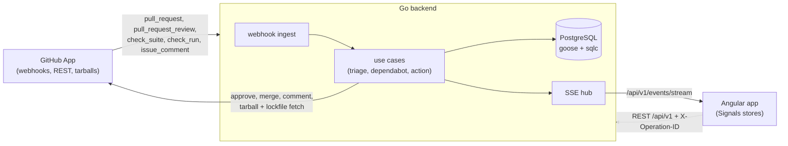
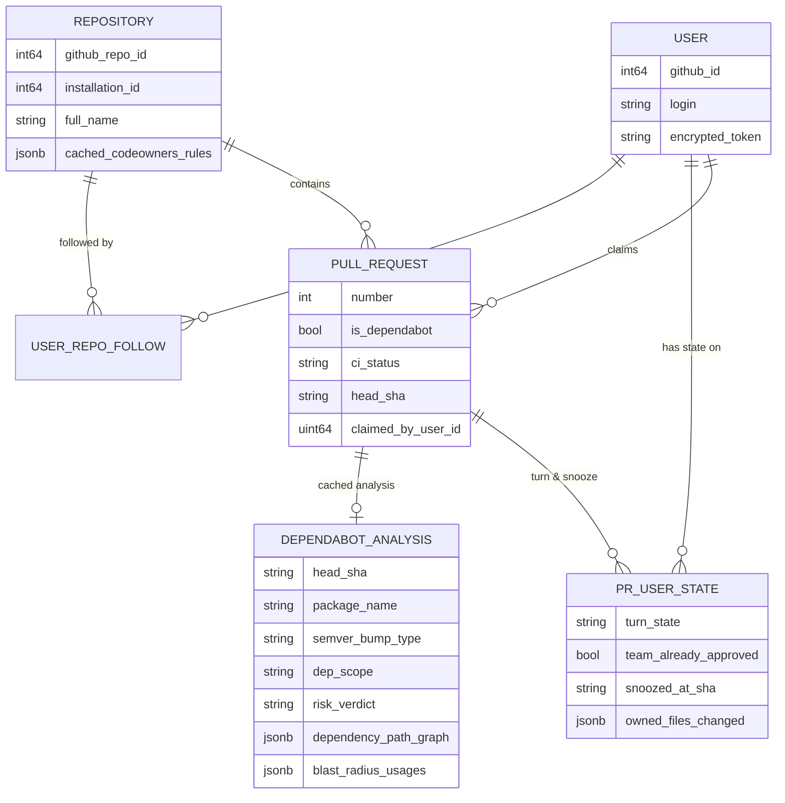
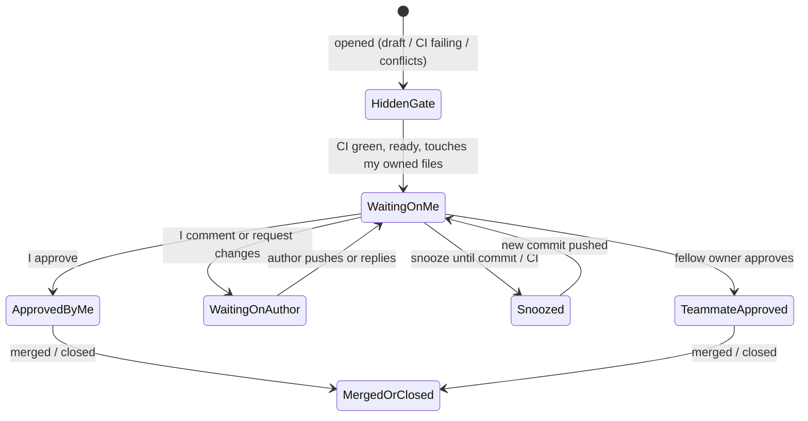

# PR Follower — Implementation Plan

Product design and roadmap behind `manifest.md`. Ported on 2026-11-10 from the plan written in the first build session (Antigravity CLI, 2026-11-09) and reconciled against the code at that date.

- **Rules** (layers, TDD, migrations, resilience, cancellation, i18n, Angular shape) live in [`docs/adr/`](adr/README.md) and are enforced by `make adr-check`. This document does not restate them.
- **Status** at the bottom is the open-work list. Tick items off, or delete them, in the same PR that finishes them.

## 1. System overview

Team-shared web app. GitHub App webhooks flow into the Go backend, which persists state, runs analyses and pushes live updates to the Angular app over SSE.

**Zero clone:** repository contents (CODEOWNERS, `package.json`, lockfiles, source imports) come from the GitHub API and in-memory tarball streaming, cached by `(repository_id, head_sha)` (ADR-0005).

## 2. Data model

Schema source of truth: `backend/internal/infrastructure/database/migrations/`. Shape:

## 3. Dependabot analysis

A pluggable `port.DependencyAnalyzer` per ecosystem (npm today, in `adapter/analyzer/nodejs`):

1. **Scope:** `dependencies` → `prod`, `devDependencies` → `dev`, lockfile only → `transitive`.
2. **Dependency path:** shortest chain root `package.json` → intermediates → target, stored as `dependency_path_graph`.
3. **Blast radius** (`adapter/analyzer/blastradius`): stream the tarball at `head_sha`, scan `.ts/.tsx/.js/.mjs` for static and dynamic imports of the package, keep path, line and a 5-line snippet.
4. **Risk verdict** (pure domain policy, `domain/service`):
   - 🟢 **Low:** dev dependency, or transitive with zero direct imports; patch/minor bump; CI passing.
   - 🟡 **Medium:** direct prod dependency with patch/minor bump, or transitive prod dependency with a major bump.
   - 🔴 **High:** direct prod dependency with a major bump and imports in production code, or CI failing.

## 4. CODEOWNERS turn-state machine

Implemented in `domain/service` (`codeowners.go`, `turnstate.go`). Only PRs touching files the user owns enter the machine.

## 5. UX (Hive-inspired)

Visual source of truth: `design/references/` (Claude Design export; tokens ported to `frontend/src/styles.css`). Low mental load first: dim what isn't actionable, act in one click, cancel anything slow.

- **Sidebar perspectives:**
  - **Minha Vez** (CODEOWNERS inbox): PRs in `WaitingOnMe`, with toggles to peek at dimmed ones (teammate approved, waiting on author, draft).
  - **Radar Dependabot:** open Dependabot PRs grouped by verdict (safe to batch merge / review blast radius / breaking), with "approve & merge selected".
  - **Seats de Repositórios:** one live tile per followed repo: open PRs, CI pulse, Dependabot queue.
  - **Linha do Tempo:** live webhook activity across followed repos.
- **Docked inspection drawer** (resizable):
  - **Dependabot PR:** verdict card, dependency path graph, release notes / CVE digest, blast-radius snippets.
  - **CODEOWNERS PR:** diff of owned files only, teammate review status, claim, approve / request changes / snooze.

## 6. Status (2026-11-10)

Done: backend core (domain, use cases, persistence, SSE, chi router, webhook HMAC verification), Claude Design references, Angular frontend (all four perspectives, drawer, i18n, cancellation, resilience), stub login/logout, ADR gate, Docker images and dev stack.

Open:

- [ ] **GitHub App auth.** `GITHUB_APP_ID` / `GITHUB_CLIENT_ID` / `GITHUB_CLIENT_SECRET` are loaded but unused. Needs OAuth user login (replacing the fabricated user in `AuthLogin`), a private-key setting, installation tokens, and passing them to the gateway (`cmd/server/main.go` builds it with no token).
- [ ] **Session auth.** The session token returned by `AuthLogin` is not verified; `resolveUserID` trusts a header. Protect `/api/v1` routes.
- [ ] **Repository selection.** UI for choosing followed repos and managing the GitHub App installation (backend has `POST /api/v1/repositories/follow` only).
- [ ] **Run the Dependabot analysis.** `AnalyzeUseCase` is built and injected into the handler but nothing calls it: trigger it from webhook ingest (and/or an on-demand cancellable endpoint) and store the result.
- [ ] **yarn / pnpm lockfiles.** `CanAnalyze` accepts them, but path reconstruction is npm lockfile v2/v3 (`buildNpmV3DependencyPath`). Verify or implement the others.
- [ ] **Outbound concurrency bound.** Plan called for a bounded worker pool on GitHub requests and honoring `X-RateLimit-Reset`; only `Retry-After` is handled today.
- [ ] **Gates from the plan not in the Makefile:** `golangci-lint run`, frontend coverage (`ng test --code-coverage`).
- [ ] **Demo data.** `POST /api/v1/demo/seed` exists for local use; decide whether it stays and gate it to non-production.
