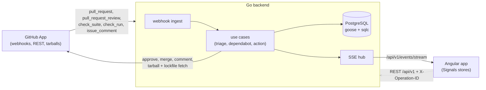
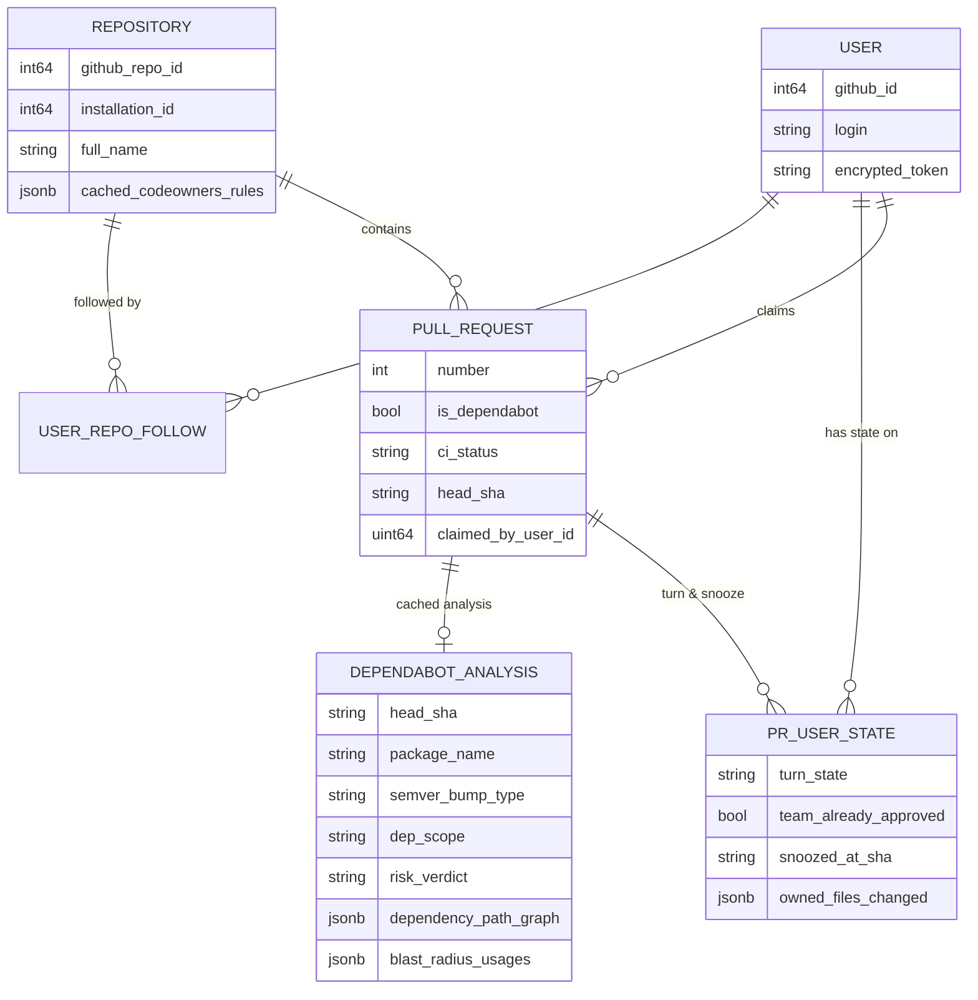
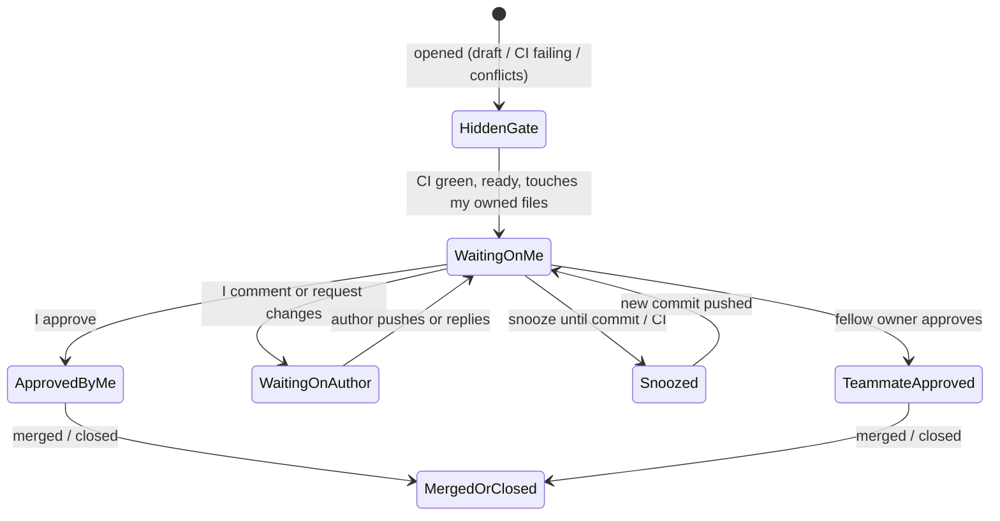

# PR Follower — Implementation Plan

Product design and roadmap behind `manifest.md`. Ported on 2026-11-10 from the plan written in the first build session (Antigravity CLI, 2026-11-09) and reconciled against the code at that date.

- **Rules** (layers, TDD, migrations, resilience, cancellation, i18n, Angular shape) live in [`docs/adr/`](adr/README.md) and are enforced by `make adr-check`. This document does not restate them.
- **Status** at the bottom is the open-work list. Tick items off, or delete them, in the same PR that finishes them.

## 1. System overview

Team-shared web app. GitHub App webhooks flow into the Go backend, which persists state, runs analyses and pushes live updates to the Angular app over SSE.

**Zero clone:** repository contents (CODEOWNERS, `package.json`, lockfiles, source imports) come from the GitHub API and in-memory tarball streaming, cached by `(repository_id, head_sha)` (ADR-0005).

## 2. Data model

Schema source of truth: `backend/internal/infrastructure/database/migrations/`. Shape:

## 3. Dependabot analysis

A pluggable `port.DependencyAnalyzer` per ecosystem (npm today, in `adapter/analyzer/nodejs`):

1. **Scope:** `dependencies` → `prod`, `devDependencies` → `dev`, lockfile only → `transitive`.
2. **Dependency path:** shortest chain root `package.json` → intermediates → target, stored as `dependency_path_graph`.
3. **Blast radius** (`adapter/analyzer/blastradius`): stream the tarball at `head_sha`, scan `.ts/.tsx/.js/.mjs` for static and dynamic imports of the package, keep path, line and a 5-line snippet.
4. **Risk verdict** (pure domain policy, `domain/service`):
   - 🟢 **Low:** dev dependency, or transitive with zero direct imports; patch/minor bump; CI passing.
   - 🟡 **Medium:** direct prod dependency with patch/minor bump, or transitive prod dependency with a major bump.
   - 🔴 **High:** direct prod dependency with a major bump and imports in production code, or CI failing.

## 4. CODEOWNERS turn-state machine

Implemented in `domain/service` (`codeowners.go`, `turnstate.go`). Only PRs touching files the user owns enter the machine.

## 5. UX (Hive-inspired)

Visual source of truth: `design/references/` (Claude Design export; tokens ported to `frontend/src/styles.css`). Low mental load first: dim what isn't actionable, act in one click, cancel anything slow.

- **Sidebar perspectives:**
  - **Minha Vez** (CODEOWNERS inbox): PRs in `WaitingOnMe`, with toggles to peek at dimmed ones (teammate approved, waiting on author, draft).
  - **Radar Dependabot:** open Dependabot PRs grouped by verdict (safe to batch merge / review blast radius / breaking), with "approve & merge selected".
  - **Seats de Repositórios:** one live tile per followed repo: open PRs, CI pulse, Dependabot queue.
  - **Linha do Tempo:** live webhook activity across followed repos.
- **Docked inspection drawer** (resizable):
  - **Dependabot PR:** verdict card, dependency path graph, release notes / CVE digest, blast-radius snippets.
  - **CODEOWNERS PR:** diff of owned files only, teammate review status, claim, approve / request changes / snooze.

## 6. Status (2026-11-10)

Done: backend core (domain, use cases, persistence, SSE, chi router, webhook HMAC verification), Claude Design references, Angular frontend (all four perspectives, drawer, i18n, cancellation, resilience), GitHub-only sign-in, ADR gate, Docker images and dev stack.

Open:

- [x] **GitHub-only sign-in** (ADR-0010): web flow with state + PKCE, server-side sessions in an HttpOnly cookie, tokens encrypted at rest and refreshed, every `/api/v1` route behind `RequireSession`, single "Entrar com GitHub" screen.
- [x] **Vercel-style repository import** (ADR-0010 §5): accounts and repositories listed with the user's token, import verified against GitHub, unfollow, "adjust permissions" / "add account" links, Setup URL returns to the import screen on the installed account. The free-form `POST /api/v1/repositories/follow` is gone.
- [x] **Installation webhooks** (ADR-0010): `installation` (deleted / suspend / unsuspend / created) and `installation_repositories` (removed / added) set each repository's `access` (`active` / `removed` / `suspended`); Seats flags repositories without access with a "Corrigir acesso" shortcut, and access events reload the workspace live.
- [x] **Truthful PR state.** CI comes from `check_run` webhooks (`NONE` when nothing was reported, so repositories without CI never look "running"); merge blockers come only from GitHub's `mergeable_state`; CODEOWNERS is read at import (`present` / `absent` / unknown); human PRs carry no risk verdict; Dependabot PRs without analysis show what their title says, sit in a "Sem análise" radar group and are never batch-merged; the drawer lists every changed file as its own card, or says the preview is not available.
- [ ] **Changed-files preview.** The drawer renders `owned_files_changed`, but nothing populates it yet: fetch the PR's files (`GET /pulls/{n}/files`) with the user's token and keep the patches the user owns.
- [ ] **Review state.** `pull_request_review` webhooks are not ingested, so the drawer cannot say who approved or requested changes; until then it says only who owns the files.
- [ ] **CODEOWNERS freshness.** It is read only at import; refresh it on `push` events to the default branch that touch a CODEOWNERS path.
- [ ] **Act as the user on GitHub.** Approve / merge / comment must call GitHub with the user's token (`auth.UseCase.AccessToken`); the gateway in `cmd/server/main.go` still has no token. Background work needs an installation token (GitHub App ID + private key settings). Per ADR-0011, check the PR's current state first (skip approving an already-approved PR, merging a merged one) and surface ambiguous failures from `RetryNonIdempotent` as "could not confirm, check GitHub".
- [ ] **Out-of-order webhooks** (ADR-0011 consequence): ignore a `pull_request` delivery older than the stored state (compare `updated_at` from the payload).
- [ ] **Expired session in the SPA.** A 401 from any API call should return the user to the sign-in screen (today only `/auth/me` is checked, at start-up).
- [ ] **Run the Dependabot analysis.** `AnalyzeUseCase` is built and injected into the handler but nothing calls it: trigger it from webhook ingest (and/or an on-demand cancellable endpoint) and store the result.
- [ ] **yarn / pnpm lockfiles.** `CanAnalyze` accepts them, but path reconstruction is npm lockfile v2/v3 (`buildNpmV3DependencyPath`). Verify or implement the others.
- [ ] **Outbound concurrency bound.** Plan called for a bounded worker pool on GitHub requests and honoring `X-RateLimit-Reset`; only `Retry-After` is handled today.
- [ ] **Gates from the plan not in the Makefile:** `golangci-lint run`, frontend coverage (`ng test --code-coverage`).
- [x] **No demo data in production.** `POST /api/v1/demo/seed`, the SPA's built-in sample workspace and the fake SSE event generator are gone; sample data lives only in test fixtures (`frontend/src/app/testing/`, `seedWorkspaceFixture` in the HTTP tests).
- [ ] **Artificial delays.** `WorkspaceStore.runSync` and `runBatchApprove` wait on purpose (2.4 s, 0.7 s per PR) to show progress; drop them once real GitHub calls provide the latency.
