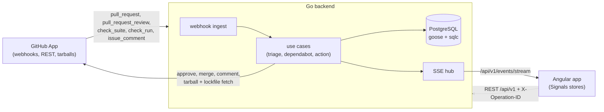
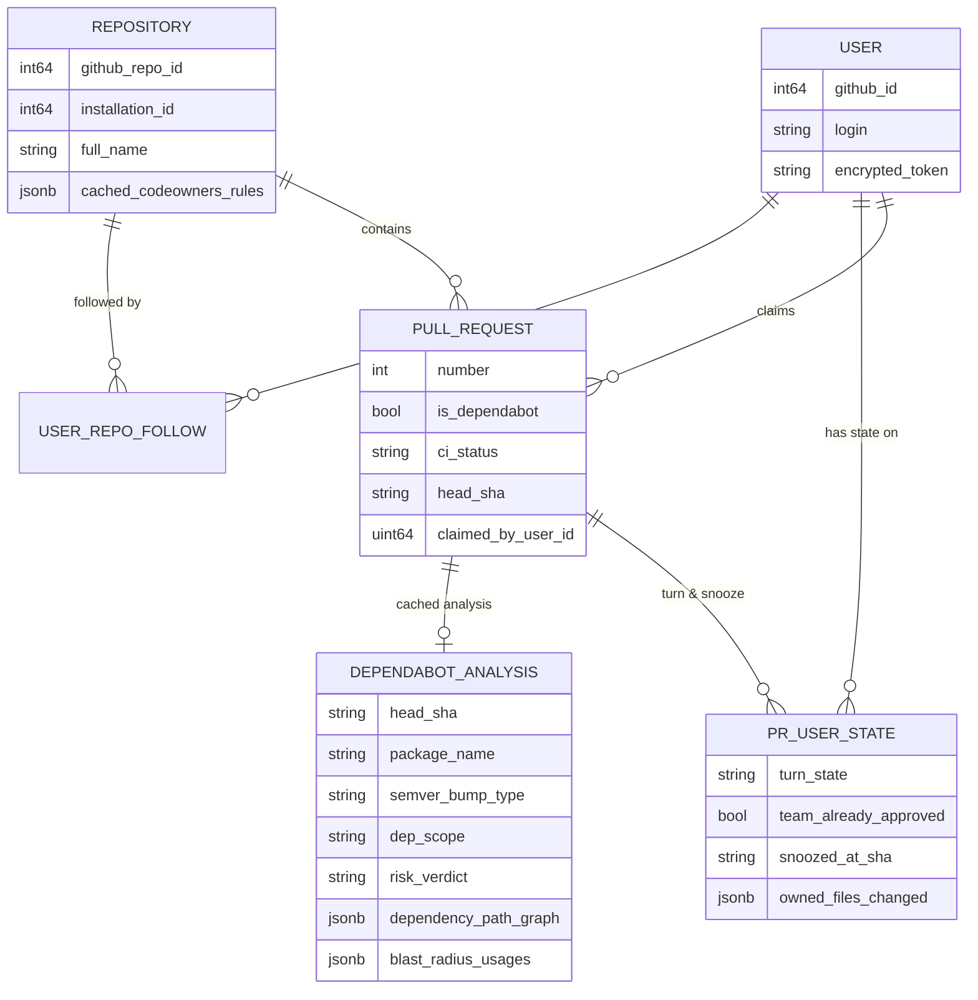
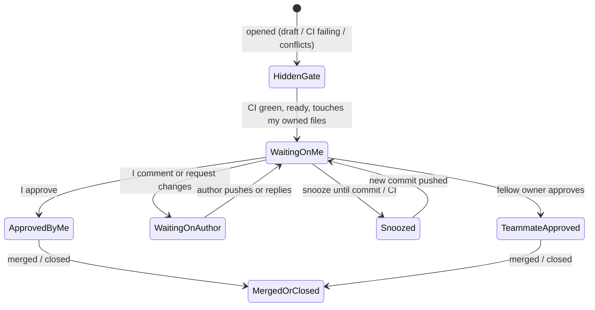

# PR Follower — Implementation Plan

Product design and roadmap behind `manifest.md`. Ported on 2026-11-10 from the plan written in the first build session (Antigravity CLI, 2026-11-09) and reconciled against the code at that date.

- **Rules** (layers, TDD, migrations, resilience, cancellation, i18n, Angular shape) live in [`docs/adr/`](adr/README.md) and are enforced by `make adr-check`. This document does not restate them.
- **Status** of every module, done and open, is in [`roadmap.md`](roadmap.md).

## 1. System overview

Team-shared web app. GitHub App webhooks flow into the Go backend, which persists state, runs analyses and pushes live updates to the Angular app over SSE.

**Zero clone:** repository contents (CODEOWNERS, `package.json`, lockfiles, source imports) come from the GitHub API and in-memory tarball streaming, cached by `(repository_id, head_sha)` (ADR-0005).

## 2. Data model

Schema source of truth: `backend/internal/infrastructure/database/migrations/`. Shape:

## 3. Dependabot analysis

A pluggable `port.DependencyAnalyzer` per ecosystem (npm today, in `adapter/analyzer/nodejs`):

1. **Scope:** `dependencies` → `prod`, `devDependencies` → `dev`, lockfile only → `transitive`.
2. **Dependency path:** shortest chain root `package.json` → intermediates → target, stored as `dependency_path_graph`.
3. **Blast radius** (`adapter/analyzer/blastradius`): stream the tarball at `head_sha`, scan `.ts/.tsx/.js/.mjs` for static and dynamic imports of the package, keep path, line and a 5-line snippet.
4. **Risk verdict** (pure domain policy, `domain/service`):
   - 🟢 **Low:** dev dependency, or transitive with zero direct imports; patch/minor bump; CI passing.
   - 🟡 **Medium:** direct prod dependency with patch/minor bump, or transitive prod dependency with a major bump.
   - 🔴 **High:** direct prod dependency with a major bump and imports in production code, or CI failing.

## 4. CODEOWNERS turn-state machine

Implemented in `domain/service` (`codeowners.go`, `turnstate.go`). Only PRs touching files the user owns enter the machine.

The turn is **derived when the workspace is read**, not stored. The stored facts are: the PR row (kept current by webhooks), the files it changes at its head commit (`pr_changed_files`, one row per PR, read from GitHub by `usecase/changedfiles`), the repository's cached CODEOWNERS rules, the reviews GitHub recorded (`pr_reviews`, one row per GitHub review id, from `pull_request_review` webhooks and the import backfill), and what the user did (snooze, claim, approval in the app). `service.DeriveReviewFacts` reads each reviewer's latest decision against the head commit, so a new push makes older reviews stale without any bookkeeping. `triage.GetWorkspaceSnapshot` evaluates ownership and calls `ComputeTurnState` for the reader, so CI, draft and conflict changes need no recomputation. A PR whose files are not known for its head commit is reported in `ownership_pending_pr_ids` and is never a turn.

## 5. UX (Hive-inspired)

Visual source of truth: `design/references/` (Claude Design export; tokens ported to `frontend/src/styles.css`). Low mental load first: dim what isn't actionable, act in one click, cancel anything slow.

- **Sidebar perspectives:**
  - **Minha Vez** (CODEOWNERS inbox): PRs in `WaitingOnMe`, with toggles to peek at dimmed ones (teammate approved, waiting on author, draft).
  - **Radar Dependabot:** open Dependabot PRs grouped by verdict (safe to batch merge / review blast radius / breaking), with "approve & merge selected".
  - **Seats de Repositórios:** one live tile per followed repo: open PRs, CI pulse, Dependabot queue.
  - **Linha do Tempo:** live webhook activity across followed repos.
- **Docked inspection drawer** (resizable):
  - **Dependabot PR:** verdict card, dependency path graph, release notes / CVE digest, blast-radius snippets.
  - **CODEOWNERS PR:** diff of owned files only, teammate review status, claim, approve / request changes / snooze.

## 6. Status

What is done and what is open, by module: [`roadmap.md`](roadmap.md). Tick items off there in the PR that finishes them.
